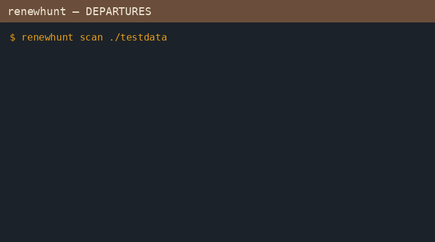

<p align="center"></p>

# renewhunt

**Will your ACME renewal survive Let's Encrypt's 64-day (then 45-day) certificates?**

On 2026-10-07 Let's Encrypt announced 64-day certificates ([blog](https://letsencrypt.org/2026/10/07/64-day-certs)): staging starts **2026-10-14**, production **2027-02-10**, then 45-day later. They told operators to *“Grep for common hardcoded numbers like 83, 80 or 60 in cron jobs, wrapper scripts and runbooks.”* renewhunt does that hunt for you — plus classifies each hit, checks ACME client / ARI readiness, and lists renew timers.

Distinct from [certfan](https://github.com/Blackman99/certfan) (live multi-IP TLS sameness): renewhunt audits **renewal automation config**, not live endpoints.



Landing: https://blackman99.github.io/renewhunt/ · Docs: https://blackman99.github.io/renewhunt/docs/

## Install

```bash
go install github.com/Blackman99/renewhunt/cmd/renewhunt@latest
```

Or download a static binary for linux / macOS / windows from [Releases](https://github.com/Blackman99/renewhunt/releases).

## Usage

```console
$ renewhunt scan ./testdata
SCAN  files=7 skipped=0 findings=6 worst=BLOCKED
SEV      FILE:LINE                                      MATCH                 REASON
BLOCKED  testdata/bad/cron-certbot-days80:2             --days 80             …
BLOCKED  testdata/bad/renew-script.sh:3                 83                    …
BLOCKED  testdata/cert-manager/certificate-720h.yaml:14 renewBefore: 720h     …
$ echo $?
1
```

`renewhunt` (no subcommand) runs scan + clients + timers. Add `-system` to also walk `/etc/letsencrypt`, cron, and systemd unit dirs. Use `-json` for scripts. Exit `1` if any finding is **BLOCKED**.

Read-only. No network required for scan.

See [GOAL.md](GOAL.md), [ROADMAP.md](ROADMAP.md), [CONTRIBUTING.md](CONTRIBUTING.md). MIT licensed.
